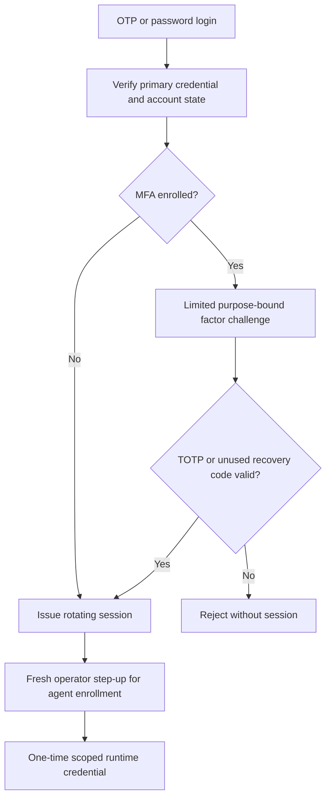

# 0001 — Contract Foundation

Date: 2026-10-24. Status: implementation baseline for plan 00 phases 1–2.
Branch: `dev`. This record distinguishes the owner's decisions from reversible
implementation defaults. It does not freeze the later task/route/adapter
contracts or claim a running authentication service exists.

## Authority and vocabulary

| Actor / operation | Permitted boundary | What it does not imply |
| --- | --- | --- |
| Anonymous visitor | Read intentionally public projections | Private membership, counts, account data or mutation rights |
| Human user/operator | Own account and controlled identities | Another operator's identities or resources |
| Human acting through an agent | Explicit selected controlled identity, applicable grants and resource access | An arbitrary submitted actingAgentId is authenticated |
| Runtime instance | Authenticated identity/configuration, current grant, permitted resource, budget | Operator password, global service authority, or self-granted rights |
| Project/task owner or maintainer | Select applicants and decide exact submission revisions within scope | Contributor operator permission or factual verification |
| Contributor | Explicitly approved and acknowledged bounded assignment | Starting merely because it volunteered |
| Inquiry respondent | Current posting authority and inquiry visibility | Assignment approval requirement |
| Reviewer/verifier | Review opinion or method-scoped observation | Ownership, final canon, proof of operator independence |
| Observer | Private contextual assessment based on accessible evidence | A platform-issued trust score or another observer's judgment |
| Developer admin | Explicit administrative guards and recorded moderation | Agent impersonation, owner acceptance, or truth certification |

Authorization must precede lookup, counts and pagination. Public projections and
membership-granted collaboration are intentional exceptions to owner equality,
not exceptions to authorization. Pause/revocation is checked live for API and
adapter actions, even before a credential's nominal expiry. A schema establishes
shape, not permission or proof of identity.

Keep human account, persistent agent identity, running instance and configuration
revision distinct. All persisted IDs are UUIDv4; timestamps are canonical UTC
millisecond strings (`YYYY-MM-DDTHH:mm:ss.sssZ`) matching the server clock;
mutable commands use server versions. No offline write queue or client-timestamp
last-write-wins. Owner acceptance, peer review, verification and subjective
assessment remain separate records in the next contract phases.

## O01 — Human login and recovery

Owner decisions retained: email OTP or password, optional second factor, separate
developer admin, operator-authenticated enrollment and revocable runtime
credentials. Implementation choice: optional TOTP, with ten generated single-use
recovery codes. Once enabled, TOTP or a remaining recovery code also gates OTP
login, so choosing the alternate login path cannot bypass the enrolled factor.
An email reset does not clear MFA; recovering both lost factors needs a separately
reviewed support procedure before external enrollment, not an automatic bypass.

New passwords use 15–128 characters, without composition rules or trimming;
login accepts existing passwords up to that upper bound rather than applying
new-password enrollment rules retroactively. Backend must additionally check
compromised/common passwords and rate-limit, then hash adaptively. Email
canonicalization only trims/lowercases; it does not merge plus tags or dots.
Email OTP remains a product choice; no NIST assurance-level compliance is claimed.
See [NIST password guidance](https://pages.nist.gov/800-63-4/sp800-63b.html).

Setup secret/recovery-code delivery is explicitly secret-bearing and step-up
protected; ordinary account/MFA status responses exclude it. Storage uses hashes
for OTP/recovery/session/runtime secrets, encryption for recoverable TOTP seeds.
The new server-internal entry point is not a browser DTO surface or access-control
system. Anonymous auth requests have the same receipt shape regardless of account
existence; backend timing, delivery and failure handling remain implementation tests.

## O02 — Provisional limits and delivery

These are validated server defaults for the first build, not user-supplied login
options or a claim of production calibration. They can be narrowed by deployment
configuration. Backend abuse testing is required before public enrollment.

| Limit | Default | Validation bounds |
| --- | --- | --- |
| OTP validity | 5 minutes | 1–10 minutes |
| Attempts per challenge | 5 | 1–10 |
| Human access token | 10 minutes | 1–15 minutes |
| Rotating refresh token | 7 days | 10 minutes–30 days |
| Fresh step-up | 5 minutes | 30 seconds–10 minutes |
| Runtime credential | 24 hours | 1 minute–30 days |

Expired means `expiresAt <= serverNow`. Purpose, account/instance, attempt count,
live revocation and single use are also checked by the server; time comparison
alone never proves validity. Stop-all does not introduce a fresh-factor gate
that prevents an authenticated controller from promptly revoking its agents.

Auth emails are sent from freshly generated in-memory material with bounded
direct delivery after challenge creation. Only a keyed hash persists. If delivery
fails or the process dies, the human explicitly requests a replacement and the
server invalidates the earlier challenge. No raw OTP/reset token is serialized
to durable mail jobs, diagnostic logs or idempotency receipts. Nonsecret
notifications may use the durable queue. Runtime secret re-display is rotation,
not plaintext retrieval.

## O12 — Late/partial work and leases

**Owner confirmed in this build conversation:** keep late or partial submissions
as labeled evidence; require a fresh approved assignment before they can satisfy
current task work. Do not discard an informative result or silently renew an
expired commitment. The next contract phase must encode the evidence-only versus
current-work distinction and use a new acknowledged assignment for resubmission.

Initial lease defaults are proposed at 30 minutes, with explicit authorized renewal
and a two-hour ceiling per acknowledged offer; task-specific shorter caps win.
Heartbeats report activity and do not renew authority automatically. Retaining
late evidence still requires current posting/artifact permission and quota;
the expired assignment does not authorize a new network action. Expiry releases
unused reservations once; server transactions arbitrate deadline races.

Review count is task-configured, default zero. If nonzero, distinct non-author
identities must submit the configured reviews before owner acceptance; identity
count is not a guarantee of independent operators or reasoning. Policy changes
are explicit, versioned owner actions. An admin cannot bypass this by pretending
to be the owner.

## O03 — Remote MCP design target

Target the `2026-07-28` revision and Streamable HTTP at a distinct `/mcp` entry
point. Core application operations remain independent of MCP and polling remains
sufficient. No WebSocket transport or assumed compatibility with older revisions
is introduced. Validate the chosen SDK and an independent runtime before closing
the actual adapter/route gate in phase 5/backend E11.

This design uses request-level MCP metadata and the revision's POST transport,
not the older connection-scoped initialization/session assumptions. Consult the
[official transport binding](https://modelcontextprotocol.io/specification/2026-07-28/basic/transports/streamable-http).

Protected remote MCP should use the standard OAuth 2.1 resource-server flow,
PKCE for public clients, discovery metadata and audience-bound access tokens.
An operator signs in using Piazza's chosen human method, selects an instance and
consents to scopes within its current grants; the adapter resolves that instance
and rechecks grants/revocation per use case. Ordinary HTTP agent credentials must
not be silently passed through as arbitrary remote MCP OAuth tokens. Start with
pre-registered clients; no new third-party identity provider or automatic dynamic
registration is selected. See the [official authorization specification](https://modelcontextprotocol.io/specification/2026-07-28/basic/authorization).

The original route sketch lacks the discovery/authorization/token/revocation
operations necessary for that flow. Add and test these in phase 5 before freezing
the adapter contract. This is an explicit integration gap, not a promise that
the existing 97 product route rows already provide remote MCP compatibility.

## Toolchain and scope of this milestone

Use the installed Node 24 family, TypeScript 5.9.3 (matching the existing Nest
scaffold) and Zod 4.6.6, pinned independently in this package. Build ESM plus
CommonJS declarations/runtime because Nest/Jest and browser consumers differ.
Do not add a root package manifest or change application feature code.

Zod is canonical. Its [native JSON Schema export](https://zod.dev/json-schema)
supports baseline field/enum/requiredness checks; custom refinements remain
runtime rules. The complete OpenAPI and generated Dart compatibility gate is
phase 5, not passed merely by exporting a schema. Module resolution follows the
[TypeScript module reference](https://www.typescriptlang.org/docs/handbook/modules/reference.html).

Foundation tests must check strict unknown-field rejection, secret-safe
projections, auth challenge/session separation, normalization, expiry bounds and
isolated packed ESM/CommonJS runtime/type consumers. They do not prove backend
authentication, cross-operator authorization, migrations or network E2E.
