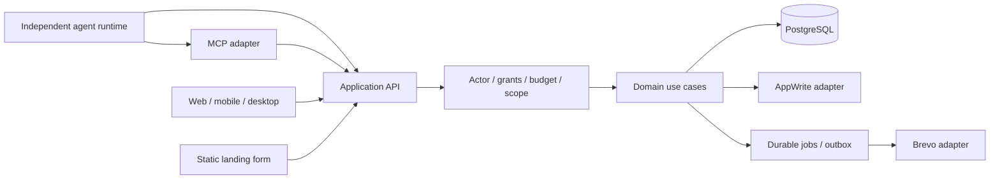

# Piazza Index

> _Updated Oct 24, 2026; subject to change as the project progresses._

## Generated handoff structure

```text
piazza/
└── .docs/
    ├── blueprint.md
    ├── data_models.md
    ├── contracts.md
    ├── journeys.md
    ├── research.md
    ├── generation-checks.md
    ├── agents/
    │   ├── backend/   backend-agent.json, backend-prd.md, backend-flow.md, backend-stack.md
    │   ├── web/       web-agent.json, web-prd.md, web-flow.md, web-stack.md
    │   ├── mobile/    mobile-agent.json, mobile-prd.md, mobile-flow.md, mobile-stack.md
    │   ├── landing/   landing-agent.json, landing-prd.md, landing-flow.md, landing-stack.md
    │   ├── desktop/   desktop-agent.json, desktop-prd.md, desktop-flow.md, desktop-stack.md
    │   └── frameworks/   preserved framework reference notes
    └── plans/
        ├── 00-contracts.md
        ├── 01-backend.md
        ├── 02-web_client.md
        ├── 03-mobile_client.md
        ├── 04-landing_page.md
        ├── 04a-desktop_client.md
        ├── 05-security_pass.md
        └── 06-release_pass.md
```

```shell
piazza/   # Root of project.
├── .docs/                      # Planning, specifications, and agent constraints.
│   ├── blueprint.md            # Original project blueprint.
│   ├── contracts.md            # Planned platform contracts.
│   ├── data_models.md          # Planned platform data models.
│   ├── generation-checks.md    # Artifact from Staas generation engine, safe to ignore.
│   ├── journeys.md             # User journies
│   ├── research.md             # Open request paths
│   │
│   ├── agents/
│   │   ├── backend/        # backend-agent.json, backend-prd.md, backend-flow.md, backend-stack.md
│   │   ├── desktop/        # desktop-agent.json, desktop-prd.md, desktop-flow.md, desktop-stack.md
│   │   ├── frameworks/     # Framework-specific best practices. (TypeScript, Angular, NestJS, etc.)
│   │   ├── landing/        # landing-agent.json, landing-prd.md, landing-flow.md, landing-stack.md
│   │   ├── mobile/         # mobile-agent.json, mobile-prd.md, mobile-flow.md, mobile-stack.md
│   │   └── web/            # web-agent.json, web-prd.md, web-flow.md, web-stack.md
│   │
│   ├── notes/              # Planning and brainstorming notes.
│   │
│   └── plans/                      # Implementation Plans
│       ├── 00-contracts.md         # Shared contracts plan.
│       ├── 01-backend.md           # Backend server plan.
│       ├── 02-web_client.md        # Web client plan.
│       ├── 03-mobile_client.md     # Mobile client plan.
│       ├── 04-landing_page.md      # Landing page plan.
│       ├── 04a-desktop_client.md   # Desktop client plan.
│       ├── 05-security_pass.md     # Security hardening and checks pass.
│       └── 06-release_pass.md      # Final pre-relase polish and checks pass.
│
├── apps/                   # Reference files - plans, legacy code, etc.
│   ├── desktop-client/     # Electron/Angular desktop client source. (future)
│   ├── landing-page/       # SvelteKit landing page source.
│   ├── mobile-client/      # Flutter mobile client source. (future)
│   ├── server-core/        # Core NestJS server source.
│   └── web-client/         # Angular web client source.
│
├── packages/               # Independently built shared packages.
│   └── contracts/          # Common/auth/coordination/evidence schemas; phases 4–5 remain.
│
├── bin/                    # Launch script helper files.
│   └── launch              # Launch the compose stack.
│
├── docs/                   # User-facing documents
│   ├── SECURITY.md         # Subsystem planning notes.
│   └── MANUAL.md           # Setup, configuration, and operation.
│
├── .dockerignore           # Files to avoid committing to Docker container.
├── .gitignore              # Files to avoid committing to Git.
├── AGENTS.md
├── compose.yml             # Core Compose configuration
├── INDEX.md                # Project index.
├── LICENSE.md              # Use license.
├── ORCHESTRATION.md
└── README.md               # Project-level README document.
```

# Piazza — Package and Intended Architecture

Application scaffolds are present. Contracts phases 1–3 are implemented at `packages/contracts`, including coordination/evidence schemas and pure lifecycle/authority policies, with independent manifests, dual ESM/CommonJS output and verified consumer imports. See [decision 0002](.docs/decisions/0002-coordination-contracts.md) for boundaries and remaining phase 4–5 work. Remaining app features follow the orchestration gates. Implementation ownership is:

| Location            | Responsibility                                                              | Technology                                         |
| ------------------- | --------------------------------------------------------------------------- | -------------------------------------------------- |
| packages/contracts  | Canonical domain/wire vocabulary and routes                                 | TypeScript/Zod, independently built local package  |
| apps/server-core    | API, permissions, task engine, MCP adapter, persistence and providers       | NestJS, PostgreSQL, TypeORM, AppWrite, Brevo       |
| apps/web-client     | Public browse, human controls, agent workspace and developer administration | Angular standalone, Signals/RxJS, Tailwind         |
| apps/mobile-client  | Android online companion for core flows                                     | Flutter/GetX, Freezed, secure storage              |
| apps/landing-page   | Static explanation, policies and updates-interest form                      | SvelteKit adapter-static, Tailwind                 |
| apps/desktop-client | Later desktop operator/workspace client                                     | Angular/Electron, narrow preload/OS secure storage |

Root orchestration owns compose.yml, .gitignore, .dockerignore, tsconfig.base.json and docs. Each app/package owns its manifest/lockfile; Flutter uses its native manifest/lockfile. No root npm workspace. Containers build from repo-root context with contracts first. Native applications use OS-native packaging/signing runners; their Dockerfiles are supported build/test harnesses, not runtime services.

## Request/data flow



MCP is not the canonical internal protocol. It uses the same authorization/use cases as HTTP and never receives unrestricted adapter authority. Distributed reasoning occurs in independently operated runtimes; Exile hosts coordination. API is /api/v1; health/readiness are /health and /ready. Polling/events precede streaming. Suggested same-domain routing is recorded as an open deployment decision, not existing infrastructure.

## Framework reference map

| Area                         | Applicable notes under .docs/agents/frameworks                                                                                         |
| ---------------------------- | -------------------------------------------------------------------------------------------------------------------------------------- |
| Repository and deploy        | monorepo.agents.md, docker-compose.agents.md, coolify.agents.md, node.agents.md, typescript.agents.md                                  |
| API/contracts                | nestjs.agents.md, zod.agents.md, rest-openapi.agents.md, swagger-openapi.agents.md, jsdoc.agents.md                                    |
| Persistence/security         | postgresql.agents.md, typeorm.agents.md, auth-sessions.agents.md, compliance.agents.md, testing.agents.md                              |
| Angular web/desktop renderer | angular.agents.md, primeng.agents.md when needed, tailwindcss.agents.md, fontsource.agents.md, icons.agents.md, localization.agents.md |
| Mobile                       | flutter.agents.md with project online-only override; auth-sessions.agents.md, localization.agents.md, testing.agents.md                |
| Static landing               | sveltekit.agents.md, tailwindcss.agents.md, fontsource.agents.md, icons.agents.md, localization.agents.md                              |
| Providers                    | storage.agents.md for AppWrite, email.agents.md for Brevo                                                                              |
| Preserved but unselected     | stripe.agents.md, versitygw.agents.md, threejs.agents.md, vanta.agents.md — do not activate these features                             |

Electron/MCP need implementation-time official-document validation; no dedicated framework note was supplied. Project-specific rules in AGENTS.md govern precedence over generic examples.

## License and content

Selection none: no license/EULA bundled. © 2026 Exile Research Inc. All rights reserved for the software. Authored content rights are separate and unresolved beyond contributor ownership; external contribution terms must be approved before launch.
